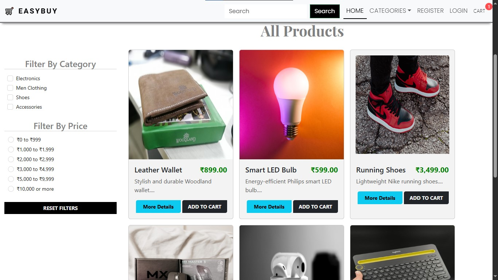
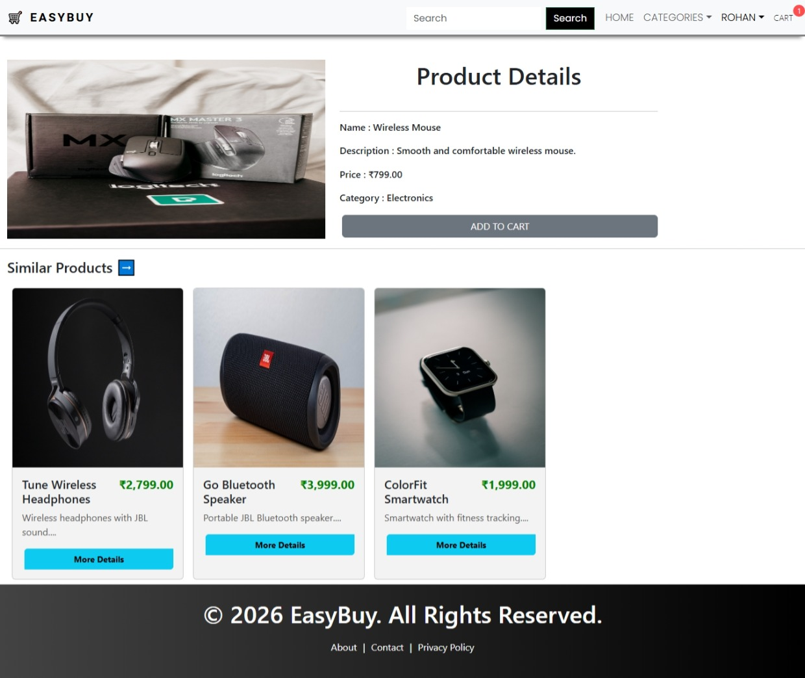
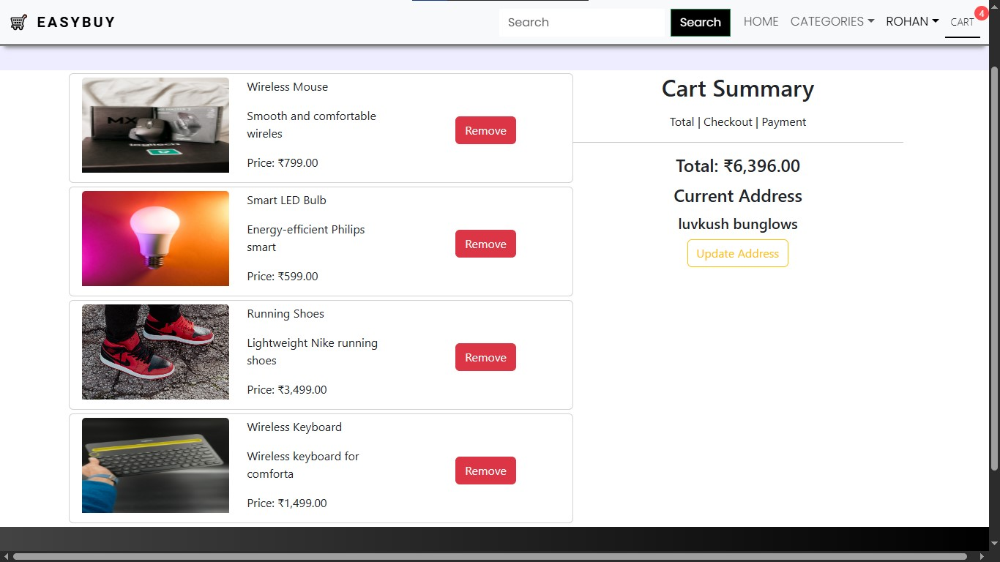
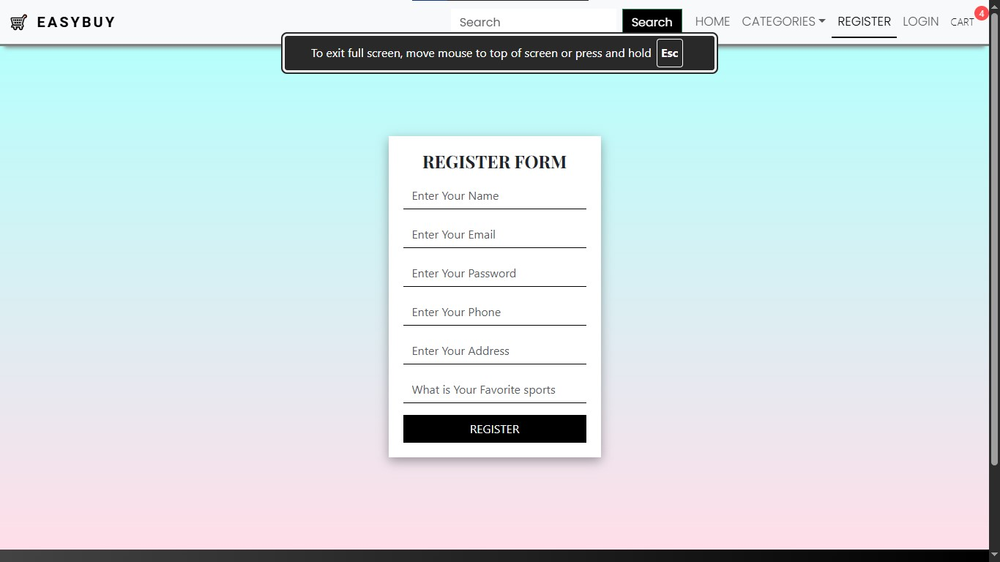
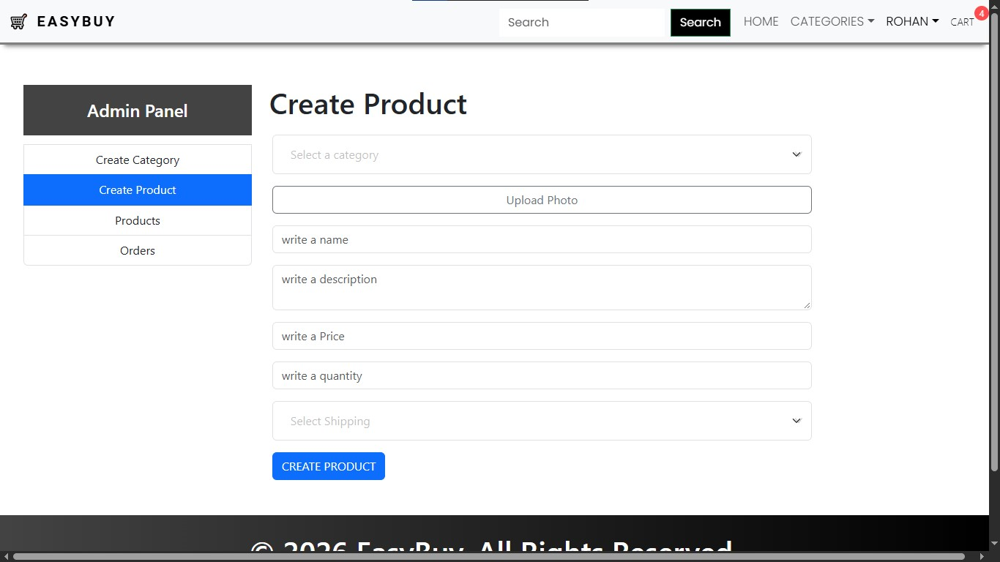

# EasyBuy – MERN Stack E-Commerce Website

A full-stack e-commerce web application built using the MERN stack (MongoDB, Express.js, React.js, and Node.js). EasyBuy provides product browsing, user authentication, shopping cart functionality, and order management.

## Features

### User Features
- User registration and login
- JWT-based authentication
- Browse and search products
- Filter products by category and price
- Product pagination
- Add and manage products in shopping cart
- Manage user profile
- Place and manage orders

### Admin Features
- Role-based access control
- Manage products and categories
- Perform CRUD operations
- Manage orders

## Technologies Used

**Frontend**
- React.js
- React Context API
- HTML5, CSS3, Bootstrap
- Axios

**Backend**
- Node.js
- Express.js
- RESTful APIs
- MongoDB
- Mongoose
- JSON Web Token (JWT)

**Tools**
- Git and GitHub
- Visual Studio Code
- npm

## Project Structure

```text
EasyBuy/
│
├── client/             # React frontend
│   ├── public/
│   ├── src/
│   └── package.json
│
├── config/             # Database configuration
├── controllers/        # Request handling and business logic
├── helpers/            # Helper functions
├── middlewares/        # Authentication and authorization
├── models/             # MongoDB models
├── routes/             # Backend API routes
│
├── seed.js             # Sample data
├── server.js           # Express server entry point
├── package.json        # Backend dependencies and scripts
├── .gitignore
└── README.md
```

## Installation and Setup

### 1. Clone the Repository

```bash
git clone https://github.com/YOUR-USERNAME/EasyBuy-MERN-Ecommerce.git
cd EasyBuy-MERN-Ecommerce
```

### 2. Install Backend Dependencies

```bash
npm install
```

### 3. Install Frontend Dependencies

```bash
cd client
npm install
cd ..
```

### 4. Configure Environment Variables

Create a `.env` file in the root directory and add the following configuration:

```env
# Server Configuration
PORT=8080
DEV_MODE=development

# MongoDB Configuration
MONGO_URL=your_mongodb_connection_string

# JWT Authentication
JWT_SECRET=your_jwt_secret
```

  


### 5. Run the Application

Start both frontend and backend together:

```bash
npm run dev
```

Alternatively, run them separately:

**Backend:**
```bash
npm run server
```

**Frontend:**
```bash
npm run client
```

## Project Highlights

- Implemented 28 REST API endpoints across 3 route modules.
- Developed JWT authentication and role-based authorization.
- Implemented product search, category filtering, price filtering, and pagination.
- Integrated shopping cart and order management.
- Added sample data containing 14 products across 4 categories.


## Screenshots

### Home Page


### Product Details


### Shopping Cart


### Registration Form


### Admin Dashboard



## Author

**Rohan Nair**


